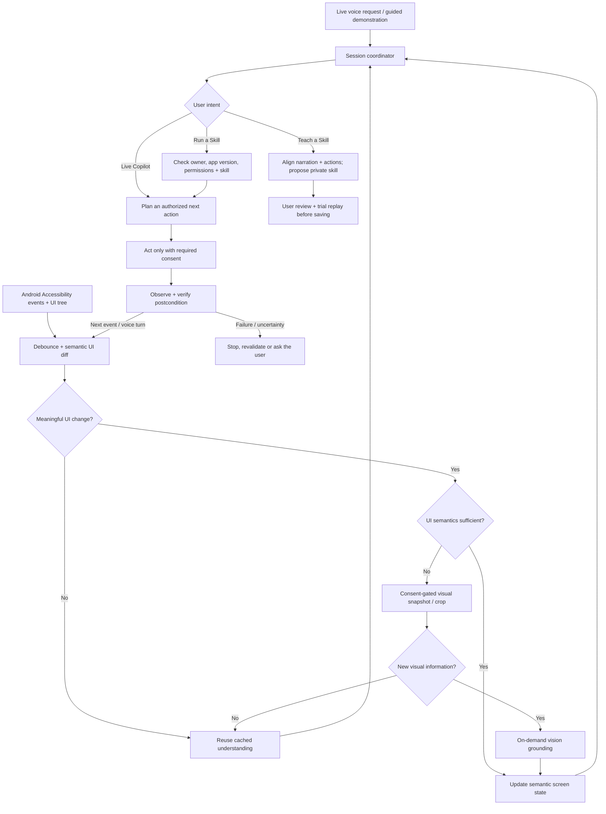

# PhoneAgent — Android on-device agent

Independent open-source Android phone agent project under Bowen-AI. **Work in progress:** a diagnostic Android app, emulator/benchmark CI, a customer-owned skill contract and a pure Kotlin guarded skill runner. **Not yet a working general-purpose cross-app AI assistant.**

## Vision

A local-first, user-authorized Android agent that can **navigate apps while talking with the user**, learn from user-guided demonstrations, and replay verified, private, reusable skills. It should work across apps using the accessible UI when possible, not depend exclusively on paid partnerships or special app-specific APIs.

Three complementary experiences are planned:

1. **Live Copilot** — hold an ongoing voice conversation while moving between apps. Observe what changed, answer questions, execute permitted actions, verify results, and accept immediate interruptions.
2. **Teach a Skill** — the customer demonstrates a task while optionally narrating *why* they are doing it. Extract semantic actions and conditions rather than assuming a video is the instruction. Review the resulting skill, validate it on their device, and save it **privately by default**.
3. **Run a Skill** — replay an approved skill on the customer's authorized apps/accounts; check app version and foreground state, require observable postconditions, stop on uncertainty, and request fresh confirmation for consequential actions.

## Hybrid observation: semantic events first, vision only when needed

**Design proposal — not implemented yet.** Instead of continuously recording and interpreting video, listen for meaningful Android Accessibility UI events and compare accessible UI-tree snapshots. Reuse cached understanding when the state is unchanged. If a task involves unlabeled graphical controls, canvas/WebView content, or an uncertain result, obtain a **permissioned visual snapshot** (ideally a region of interest) and avoid repeated vision inference on redundant frames. Screenshots and secure content may be unavailable or restricted by Android/the app.



### Design rules

- **Event-driven, not FPS-driven:** clicks, scrolling, window/package changes, relevant content updates, spoken requests, and verification failures can trigger an observation. No continuous video inference by default.
- **Adaptive visual fallback:** inspect screenshots only when accessible structure is insufficient, a visual question is asked, or postcondition verification is uncertain. Suppress identical frames with hashes/diffs and cache invalidation.
- **Don't assume static pixels imply static state:** some actions or animations change semantics without a meaningful frame difference. Screen/context freshness and lightweight session liveness still matter.
- **Context-aware matching:** resource IDs/package names/parameters are exact and case-sensitive; UI-facing labels can use context-scoped case-insensitive matching. Never rely solely on coordinate replay; re-check screen and element context before acting.
- **Verified actions:** a dispatched tap is not a completed task. Verify the target app and expected result after each action. Stop on stale state, unsupported UI, missing permissions, or a failed postcondition.
- **Privacy and control:** capture and microphone are explicit opt-ins; no silent recording. Customer skills are private by default. Do not retain secrets or raw screens as skill parameters. Purchases, sending, deletion, and similarly consequential actions require fresh authorization.
- **Permissions aren't universal:** some apps hide accessibility semantics, restrict screen capture or use secure/DRM surfaces. Logged-in or paid access must come from the customer's legitimate entitlements; PhoneAgent must not bypass paywalls.

Example of a *proposed* semantic skill, rather than pixels or touch coordinates:

```json
{
  "targetApp": "example.streaming",
  "parameters": ["title"],
  "steps": [
    {"action": "open_app"},
    {"action": "tap", "target": {"role": "button", "label": "Search"}},
    {"action": "enter", "field": "Search", "value": "$title"},
    {"action": "tap", "target": {"semantic": "matching_title"}},
    {"action": "verify", "expected": "title_details_visible"}
  ]
}
```

The example is illustrative, not an implemented parser or a proven Hulu/other-app skill.

## Project status

| Area | Current status |
| --- | --- |
| Android diagnostic app + opt-in AccessibilityService | Implemented; manual observation and basic navigation |
| Android debug build / JVM tests / emulator smoke checks | GitHub Actions workflows exist; emulator tests exercise app launch and opening Android Settings |
| Latency schema + Python analyzer | Implemented; no real Pixel measurements reported |
| Customer-owned skill schema/version checks | Implemented in Kotlin |
| Guarded skill trial/replay policy | Implemented as pure Kotlin code with mock-device tests; **not connected to production Android actions** |
| Live voice session and agent planner | Planned |
| Semantic event-diff observer + screenshot deduplication | Planned |
| On-demand visual grounding | Planned |
| Teach-from-narration extraction, private skill library, real-app replay | Planned |
| Video-only tutorial capture service | Experimental branch work; not a complete, merged user-facing recording workflow |

See [hybrid Live Copilot issue #4](https://github.com/Bowen-AI/PhoneAgent/issues/4), [skill design](docs/customer-taught-skills.md), [guarded replay limitations](docs/guarded-skill-replay.md), and [architecture](docs/architecture.md).

## Testing and measurable acceptance criteria

All source changes should be tested on pushes and pull requests. The repository currently has Android debug build/unit-test, Python analyzer, and Android emulator smoke-test workflows; **mandatory branch-protection checks are not yet configured**. No claimed emulator pass implies reliable automation of arbitrary third-party apps.

Future hybrid tests must include:

- Static accessible screen: no repeated expensive vision inference during a long idle period.
- Real semantic transitions: correctly invalidate cached UI state and verify each action.
- Graphical-only control: consented single-frame/cropped-image fallback; unchanged frames do not retrigger vision.
- User interruption: stop pending actions promptly and preserve consistent session/skill state.
- App update, missing subscription, inaccessible screen, permission loss and stale selectors: fail safely with explicit reason.
- Speech-to-action and end-to-end success/latency: report trial counts, failures, p50/p90/p95, memory, battery, model calls, capture count and thermal state. Compare semantic-only, hybrid, and continuous-vision **under the same workload**; use a physical Pixel for realistic metrics.

A simulator/emulator is suitable for deterministic mock-app functionality, not authoritative phone performance or paid content playback. No real-device performance numbers are available yet.

## Repository layout

- `app/` — Kotlin Android diagnostics, AccessibilityService, skill schema, and guarded replay contract/engine.
- `docs/architecture.md` — high-level architecture; `docs/customer-taught-skills.md` — tutorial-to-skill lifecycle.
- `docs/guarded-skill-replay.md` — policy, tests, and current execution limitations.
- `docs/benchmark_protocol.md` — measurement and correctness protocol.
- `benchmarks/schema.md` — JSONL measurement schema.
- `tools/summarize.py` — latency/success summaries.
- `tests/test_summarize.py` — Python analyzer regression tests.
- `.github/workflows/` — Android build/unit tests, benchmark analyzer tests, and emulator smoke tests.

## Local testing

```bash
python3 -m unittest discover -s tests -v
python3 tools/summarize.py --help
gradle :app:assembleDebug :app:testDebugUnitTest
```

For Android development, install Android SDK API 35 / Build Tools and a compatible Gradle installation (CI uses Gradle 8.10.2). Install only on a test device and explicitly grant Accessibility access after reviewing the code.

## Source provenance

Conceptual reference: [PokeClaw](https://github.com/agents-io/PokeClaw), Apache 2.0. PhoneAgent's starter implementation is independently written and does not incorporate PokeClaw source. Preserve third-party notices for any later code imports.
